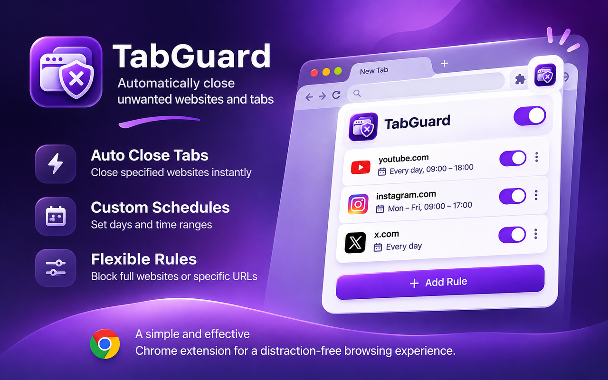

<div align="center">
  # TabGuard

  **Your browser. Your rules.**

  Automatically close unwanted websites and tabs with flexible rules and schedules.

  
</div>

## A cleaner browsing experience

TabGuard is a lightweight Chrome extension that automatically closes tabs matching the website rules **you** create. Block entire domains or specific pages, choose when rules are active, and pause protection whenever you need to.

No account, subscription, backend, or setup wizard required.

## Features

| | Feature | What it does |
|---|---|---|
| 🛡️ | **Automatic tab closing** | Closes tabs that match your enabled rules. |
| 🎯 | **Flexible URL matching** | Match an entire domain, its subdomains, a URL path, or one exact address. |
| 🗓️ | **Custom schedules** | Choose weekdays and multiple time ranges for individual rules. |
| 🌙 | **Overnight support** | Set schedules that cross midnight. |
| ⚡ | **One-click pause** | Enable or disable protection globally. |
| ✏️ | **Rule management** | Add, edit, enable, disable, and delete rules. |
| 🔒 | **Local-first privacy** | Store your rules and preferences locally in Chrome. |
| 🌍 | **8 languages** | English, Turkish, German, French, Spanish, Brazilian Portuguese, Japanese, and Russian. |

## How it works

1. Open TabGuard from the Chrome toolbar.
2. Add a website, such as `youtube.com`.
3. Choose **Exact match** for one specific URL, or leave it off to include matching pages and subdomains.
4. Optionally set days and times when the rule should apply.
5. Save the rule. TabGuard automatically closes matching tabs while protection is enabled.

### Rule examples

| Rule | Exact match | Result |
|---|---|---|
| `youtube.com` | Off | Matches the domain, subdomains, and pages. |
| `youtube.com/shorts` | Off | Matches `/shorts` and its child paths. |
| `youtube.com/watch?v=123` | On | Matches only that specific URL path and query. |

> **Note:** Chrome may briefly display a page before TabGuard closes its tab. Scheduled checks are approximate, not guaranteed to run at an exact second.

## Installation

### Install locally (developer mode)

1. Download or clone this repository.
2. Open `chrome://extensions` in Google Chrome.
3. Enable **Developer mode**.
4. Click **Load unpacked**.
5. Select the folder containing `manifest.json`.
6. Pin TabGuard to your browser toolbar and add your first rule.

<!-- After publication, add your verified Chrome Web Store URL here. -->

## Privacy by design

TabGuard checks open-tab URLs **locally** against the rules you configure. Rules, schedules, and preferences are stored using `chrome.storage.local`. The current v1.0.0 implementation does not send browsing URLs, rules, or analytics to an external server.

| Permission | Why it is needed |
|---|---|
| `tabs` | Inspect tab URLs and close matching tabs. |
| `storage` | Save rules and settings locally. |
| `alarms` | Recheck scheduled rules periodically. |

There is no account system, advertising SDK, or payment integration in v1.0.0.

## Supported languages

🇬🇧 English · 🇹🇷 Türkçe · 🇩🇪 Deutsch · 🇫🇷 Français · 🇪🇸 Español · 🇧🇷 Português (Brasil) · 🇯🇵 日本語 · 🇷🇺 Русский

The interface follows your Chrome language where a translation is available.

## Project structure

```text
TabGuard/
├── manifest.json          # Chrome extension manifest (MV3)
├── background.js          # Background service worker
├── rules.js               # URL matching and schedule logic
├── popup.html             # Extension interface
├── popup.css              # Styles
├── popup.js               # Interface behavior
├── icons/                 # Extension icons
├── _locales/              # Translations for 8 languages
└── assets/                # GitHub README images
```

**Tech stack:** Vanilla JavaScript, HTML, CSS, Chrome Extension APIs (Manifest V3). No build tools or external runtime dependencies.

## Limitations

- TabGuard is **not** tamper-proof parental-control software: users can disable or uninstall the extension.
- Chrome internal pages and other restricted URLs cannot always be managed.
- Closing happens after Chrome reports tab activity, so a page may appear briefly.
- Scheduled enforcement may be delayed by browser service-worker or alarm behavior.

## Feedback and contributions

Found a bug or have an idea? Open a GitHub Issue in this repository. Pull requests are welcome.

---

<div align="center">
  <strong>TabGuard</strong> · Simple, private, and free.<br />
  Made for a more intentional browsing experience.
</div>
